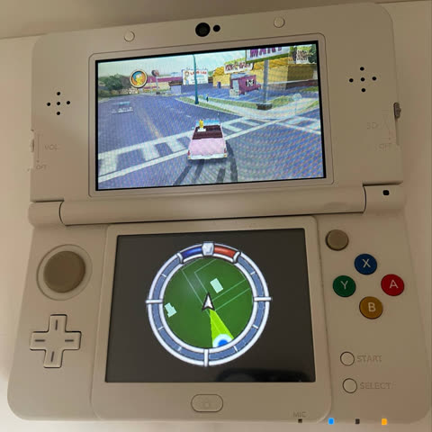

# The Simpsons Hit & Run - New Nintendo 3DS

A port of The Simpsons Hit & Run to the New Nintendo 3DS, using the data from the PC version of the game.



You need a New 3DS or New 2DS XL and a copy of the PC game (the official release).

## Building

Install [devkitPro](https://devkitpro.org/wiki/Getting_Started) with `3ds-dev`, `3ds-sdl` and `3ds-libpng`, and Python with `pip install imageio-ffmpeg`. Then:

```
build.bat "C:\Program Files (x86)\Vivendi Universal Games\The Simpsons Hit & Run"
```

This converts the game data and movies into `sdcard/`, builds the game and puts `SimpsonsNTSC.3dsx` next to the data. Copy `sdcard/3ds` to the root of the SD card and launch it from the Homebrew Launcher.

Sound needs `sd:/3ds/dspfirm.cdc`, dumped once with the DSP1 homebrew.

## Credits

Based on [ZenoArrows' Switch and PS Vita port](https://github.com/ZenoArrows/The-Simpsons-Hit-and-Run).

Movie playback follows [REGTA-3DSPort-Complete](https://github.com/Epic0522/REGTA-3DSPort-Complete) by Epic0522.

Built with devkitPro, libctru and citro3d.
